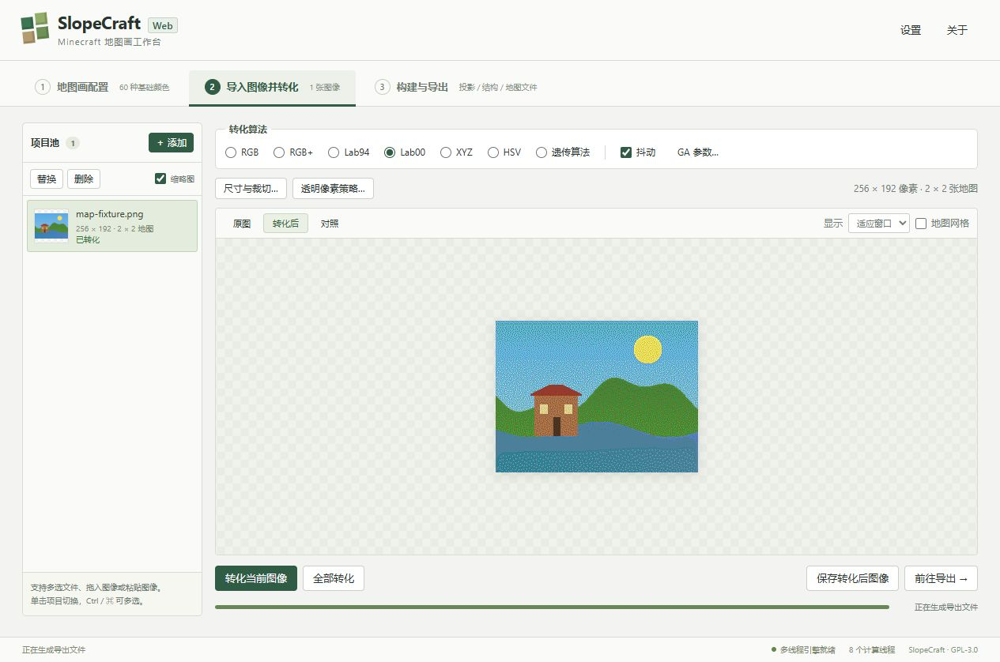

# SlopeCraft Web

**中文** | [English](README-en.md)

[项目源码](https://github.com/sitbat/SlopeCraft-Web)

在浏览器中制作 Minecraft 地图画的纯静态网页应用。基于 [SlopeCraft](https://github.com/SlopeCraft/SlopeCraft) 5.4.1，保留原 C++ 转换、三维构建和文件导出算法，以 WebAssembly SIMD 和 pthreads 运行。

部署时只需静态文件托管；图像处理和计算在浏览器中完成，不需要计算后端、账号或数据库服务器。这是从 Web 初始源码快照建立的独立仓库，Git 历史从该快照开始，不继承上游提交历史。仓库仅包含 Web 应用、其所需的 C++ 组件和资源。原作者为 **TokiNoBug 与 SlopeCraft 贡献者**，版权与 GPL 声明保留，原桌面项目文档见[上游归档](docs/upstream/README.zh-CN.md)，来源基准见 [UPSTREAM.md](UPSTREAM.md)。



## 功能

- **地图画配置**：立体、平面、纯文件模式；Java 1.12–1.21、26.1.2、26.2；原版与附加方块列表、原程序四套预设、逐基色选块、自定义 ZIP 方块包及预设导入导出。
- **图像与转换**：批量导入、拖放和粘贴，裁切、缩放、透明像素处理；RGB、RGB+、HSV、XYZ、Lab94、Lab00、遗传算法与抖动；原图、结果和对照预览。
- **构建与材料**：无损／有损压缩、最大高度、搭桥、辅助方块、防火、防末影人、蘑菇连接；压缩效果、材料表与 CSV。
- **导出**：Litematica、原版结构 NBT、WorldEdit 原理图、平面施工图、地图数据文件、获得地图的命令和展示框组装结构；批量结果自动打包 ZIP。
- **工具与缓存**：真实当前颜色表 PNG／CSV、方块列表测试结构；IndexedDB 计算结果缓存、缓存统计与清理、内存预算和本地设置保存。

修改图像或配置后，旧结果会失效，导出时自动重新计算。计算缓存用于降低当前项目池的内存占用，**刷新页面不会恢复图像项目池**；关闭前请导出所需文件并另存原图。

## 本地运行

需要 **Node.js 22 或更新版本**。网页源文件和预编译引擎位于 `web/`，无需安装 SDK 或重新编译即可预览；`prepreview` 会自动准备资源，本地预览脚本只监听回环地址，并为开发预览添加所需隔离响应头。

```sh
# 在仓库根目录执行；这些脚本不需要安装 npm 依赖。
npm run preview
```

打开脚本输出的 `http://127.0.0.1:4173`。这用于本地开发和验收；生产部署的网络、证书、跳转与服务器配置由部署者负责。

## 静态部署

当前通过源码方式预览，或按下文“从源码构建引擎”生成静态文件。将生成的 **`web/dist/` 全部内容**作为同一站点的静态文件托管。打包脚本还会在仓库的上一级目录生成 `SlopeCraft-Web-static.zip`。支持站点根目录或子目录，运行时资源使用相对 URL，不依赖 CDN；部署运行不需要 Node、Python、Qt 或 Emscripten。

浏览器必须满足以下条件：

- 正式部署使用 **HTTPS 安全上下文**；本地开发可使用 localhost／回环地址。
- 支持 WebAssembly SIMD、Web Worker、SharedArrayBuffer。
- 满足跨源隔离，`crossOriginIsolated === true`。通常需要部署者提供 `Cross-Origin-Opener-Policy: same-origin` 和 `Cross-Origin-Embedder-Policy: require-corp` 响应头。

**仅提供多线程引擎，没有单线程回退。** 单独启用 HTTPS 不等于跨源隔离；直接双击 HTML 文件也不能运行本项目。设置对话框会显示实际运行环境，缺少条件时明确报错。本仓库不自动修改生产服务器配置。

## 从源码构建引擎

预览可用 Node.js 22+；开发与 CI 使用 Node.js 24。完整引擎构建还需要 CMake 3.29+、Ninja，以及已安装并激活的 **Emscripten 4.0.23**。将 `EMSDK` 设置为 SDK 根目录；`CMAKE`、`NINJA` 可按需指定可执行文件路径。

```sh
npm run build:wasm
npm run assets
npm test
node web/scripts/package-dependencies.mjs
npm run build
node web/scripts/check-static.mjs
```

Web 构建入口是 [`web/CMakeLists.txt`](web/CMakeLists.txt)。依赖版本与下载哈希记录在 [`web/dependency-lock.json`](web/dependency-lock.json)，下载发生在构建阶段。Web 构建不需要 Qt 或原生 OpenMP。

默认构建目录为 `build/web`，可用 `SC_BUILD_DIR` 调整，`SC_BUILD_JOBS` 控制编译并行度。`package-dependencies.mjs` 从同一构建目录收集对应依赖源码与许可证，再由 `npm run build` 打包；生成的依赖源码目录和 `web/dist/` 不纳入 Git。

打包产物包含修改版项目源码、对应依赖源码和许可证。完整使用与构建细节见 [`web/README.md`](web/README.md)，第三方组件见 [`web/THIRD_PARTY_NOTICES.md`](web/THIRD_PARTY_NOTICES.md)。

## 测试与已知差异

```sh
npm test
node web/scripts/check-static.mjs
# 可选：Node WASM 基准
node web/tests/benchmark.mjs
```

静态文件校验需先执行 `npm run build`。测试加载真实的多线程 WASM，不用 JavaScript 近似算法替代。当前保存的验收记录为 **113 项测试通过**，覆盖算法、并行工作计数、地图分割、结构语义、透明策略、方块图标与原生缓存。详见[功能核对表](web/tests/parity-checklist.md)和[验收记录](web/test-results/verification.json)。

浏览器已在 Windows Chromium 环境验收导入、转换、构建、材料、下载、缓存和 390／633／1280 像素宽度布局。响应式视口测试不代表手机真机测试；Node 基准不代表浏览器性能。导出文件经过独立格式解析，尚未逐种在 Minecraft 内导入验收。

- 功能范围为 **SlopeCraft 主程序的 Web 移植**；VisualCraft、独立 MapViewer、独立 imageCutter 未迁移，其桌面程序源码也不包含在本仓库中。网页内提供裁切和缩放。
- 浏览器文件选择、下载和存储替代任意本地路径操作；界面目前为中文，没有桌面自动更新和系统内存探测。
- 保留原稠密三维矩阵。默认计算预算 1536 MiB，可设为 128–3072 MiB；这是预检查阈值，不保证浏览器能分配相应内存。大图应缩小或拆分。
- “停止后续任务”在当前 C++ 调用结束后停止队列，不会强制中断当前计算。
- WorldEdit 导出不支持 Java 1.12；平面施工图仅支持平面地图画。

## 源码结构

| 路径 | 内容 |
| --- | --- |
| `web/` | 网页界面、Worker、缓存、Web 构建与打包脚本 |
| `web/native/` | C++ ABI、pthread 调度与浏览器适配 |
| `web/tests/` | 真实引擎测试、独立 NBT／PNG 解析与核对表 |
| `SlopeCraftL/`、`utilities/` | 保留并适配的原 C++ 算法和导出库 |
| `Blocks_SCL/` | 原方块列表、纹理及附加列表 |
| `SlopeCraft/others/presets/` | Web 应用使用的四套原预设 |
| `docs/upstream/` | 原桌面项目中英文 README 归档 |

本移植基于上游提交 [`d4cda09853fe83141e155cb3a5280ce22ad9cd3a`](https://github.com/SlopeCraft/SlopeCraft/commit/d4cda09853fe83141e155cb3a5280ce22ad9cd3a)。原项目相关教程与地图画原理见 [SlopeCraft 文档](https://slopecraft.readthedocs.io/)。

## 贡献与反馈

提交修改前请阅读 [CONTRIBUTING.md](CONTRIBUTING.md)，安全问题请按 [SECURITY.md](SECURITY.md) 报告。Web 构建流程见 [GitHub Actions 配置](.github/workflows/web.yml)。

## 许可证与致谢

项目沿用 **GPL-3.0-or-later**，见 [LICENSE](LICENSE)。保留 TokiNoBug 和原项目贡献者的版权与作者声明；本仓库的 Web 界面、适配和修复不表示由上游官方发布。依赖组件遵循各自许可证，声明及对应源码说明见 [`web/THIRD_PARTY_NOTICES.md`](web/THIRD_PARTY_NOTICES.md)。
